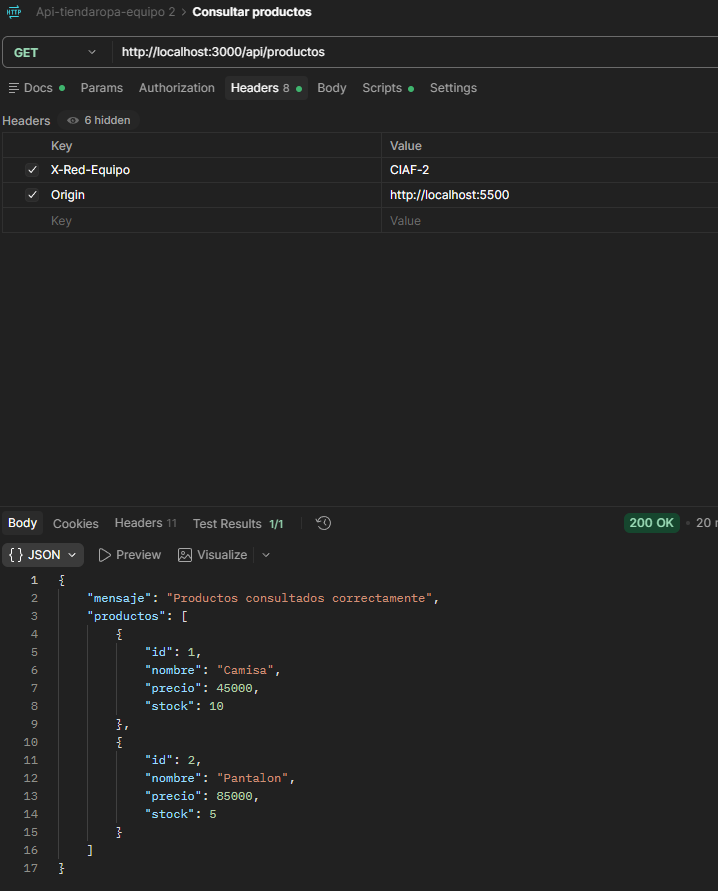
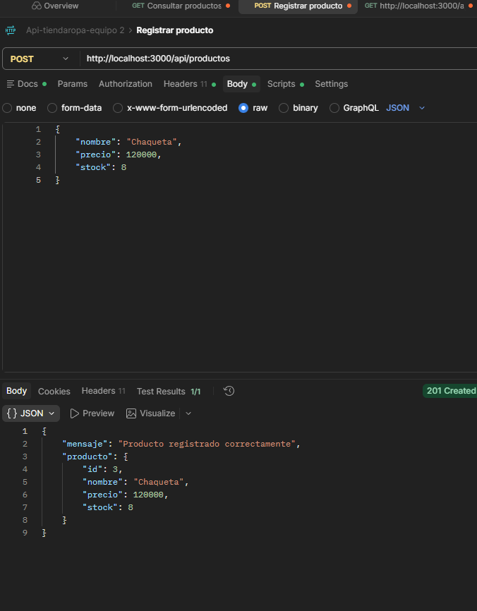
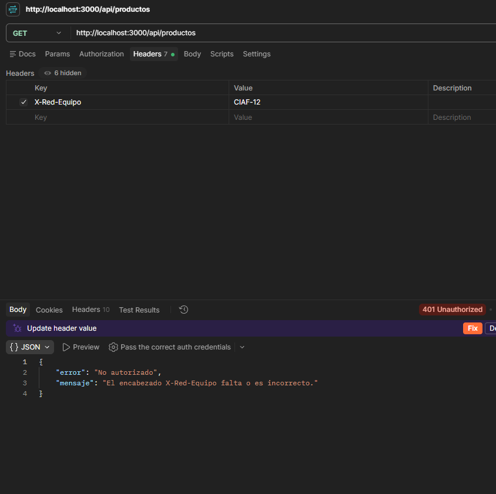
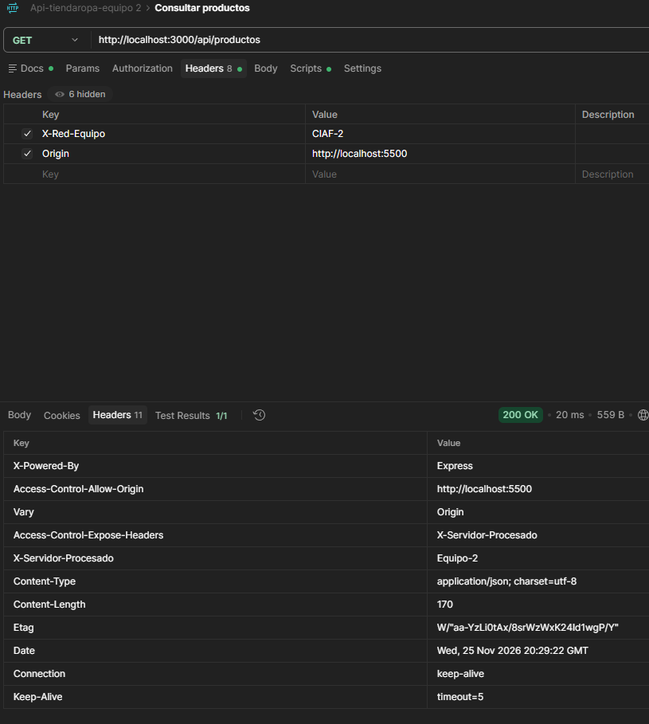

# API de Consulta y Registro de Productos - Tienda de Ropa

**Equipo:** 2  

**Integrantes:**

2 Arias Rodriguez Juan Pablo 

10 Grisales Echeverri Giancarlo 

12 Lopez Marin Santiago 

23 Ramirez Montoya Deyver Alejandro 

**Tecnologías:** Node.js, Express, CORS y Postman.

## 1. Descripción del proyecto

El proyecto consiste en desarrollar un servicio web utilizando Node.js y Express para consultar y registrar productos de una tienda de ropa.

El servicio permite consultar los productos disponibles mediante una solicitud GET y registrar nuevos productos mediante una solicitud POST.

Además, implementa encabezados HTTP personalizados, validación de acceso y políticas de seguridad CORS para controlar las solicitudes que recibe el servidor.

## 2. Escenario de red

El escenario seleccionado corresponde a una tienda de ropa que necesita administrar y consultar sus productos mediante un servicio web.

La API permite consultar información como el nombre, precio y cantidad disponible de los productos. También permite registrar nuevos productos en el sistema.

### Cliente que consume el servicio

El servicio puede ser consumido por:

- Un navegador web desde una aplicación de la tienda.
- Una aplicación móvil utilizada por los empleados.
- Un servidor externo encargado de consultar el inventario.

### Riesgos de utilizar HTTP sin cifrado

Si la comunicación se realiza mediante HTTP sin cifrado, la información puede viajar sin protección.

Esto puede generar los siguientes riesgos:

- Interceptación de la información transmitida.
- Lectura de los datos enviados entre cliente y servidor.
- Modificación de las solicitudes durante la comunicación.
- Exposición de credenciales y datos importantes.

Por esta razón se recomienda utilizar HTTPS mediante SSL/TLS para proteger la comunicación.

## 3. Tecnologías utilizadas

- **Node.js:** entorno que permite ejecutar JavaScript en el servidor.
- **Express:** framework utilizado para crear el servidor y sus endpoints.
- **CORS:** middleware que permite controlar los orígenes autorizados.
- **Postman:** herramienta utilizada para realizar y verificar solicitudes HTTP.
- **HTTP:** protocolo utilizado para la comunicación entre cliente y servidor.
- **TCP/IP:** conjunto de protocolos que permite la transmisión de información por la red.
- **SSL/TLS:** tecnología utilizada para proteger las comunicaciones mediante cifrado.

## 4. Endpoints implementados

La API utiliza la dirección local:

http://localhost:3000

### GET /api/productos

Permite consultar los productos registrados en el servidor.

**Método:** GET

**Ruta:** /api/productos

**Respuesta esperada:** 200 OK.

### POST /api/productos

Permite registrar un nuevo producto enviando información en formato JSON.

**Método:** POST

**Ruta:** /api/productos

**Ejemplo de información enviada:**

```json
{
    "nombre": "Chaqueta",
    "precio": 120000,
    "stock": 8
}
```

**Respuesta esperada:** 201 Created.

## 5. Encabezados HTTP personalizados

El proyecto implementa un encabezado obligatorio para validar que las solicitudes pertenezcan al equipo autorizado.

### Encabezado de solicitud

**Nombre:** X-Red-Equipo

**Valor obligatorio:** CIAF-2

Todas las solicitudes a los endpoints de la API deben incluir este encabezado.

Si el encabezado no existe o su valor es incorrecto, el servidor responde con:

**Código:** 401 Unauthorized.

**Respuesta JSON:**

```json
{
    "error": "No autorizado",
    "mensaje": "El encabezado X-Red-Equipo falta o es incorrecto."
}
```

### Encabezado de respuesta

El servidor devuelve un encabezado personalizado en todas las respuestas exitosas:

**Nombre:** X-Servidor-Procesado

**Valor:** Equipo-2

Este encabezado permite identificar qué equipo procesó correctamente la solicitud.

## 6. Configuración CORS

Se utiliza el middleware CORS de Express para permitir solicitudes desde un origen específico.

**Origen permitido:**

http://localhost:5500

El servidor devuelve el encabezado:

**Access-Control-Allow-Origin:**

http://localhost:5500

Esta configuración permite que una aplicación web ubicada en ese origen pueda consumir el servicio desde un navegador.

También se configuran los métodos GET y POST y los encabezados permitidos Content-Type y X-Red-Equipo.

El encabezado X-Servidor-Procesado se expone mediante la configuración de CORS para que pueda ser leído por aplicaciones web autorizadas.

## 7. Relación con el modelo TCP/IP

La comunicación entre Postman y el servidor Express se puede explicar mediante las cuatro capas del modelo TCP/IP.

### Capa de Aplicación

En esta capa se encuentra HTTP, protocolo utilizado para la comunicación entre Postman y el servidor Express.

Aquí se utilizan los métodos GET y POST, los encabezados HTTP y los datos enviados en formato JSON.

### Capa de Transporte

Se utiliza TCP para establecer una comunicación confiable entre el cliente y el servidor.

En este proyecto el servidor utiliza el puerto 3000.

### Capa de Internet

Esta capa utiliza el protocolo IP para identificar el origen y destino de los paquetes de información.

En las pruebas locales se utiliza la dirección 127.0.0.1, que corresponde al equipo local.

### Capa de Acceso a Red

Esta capa permite transmitir los datos mediante la tecnología de red utilizada, como Ethernet o Wi-Fi.

Se encarga de la transmisión de la información a través del medio de comunicación.

## 8. Funcionamiento de SSL/TLS y HTTPS

SSL/TLS protege la comunicación entre el cliente y el servidor.

Su funcionamiento permite:

- Cifrar los datos transmitidos para evitar que terceros puedan leerlos fácilmente.
- Verificar la identidad del servidor mediante certificados digitales.
- Proteger la integridad de la información transmitida.
- Reducir el riesgo de interceptación y modificación de los datos.

HTTPS utiliza TLS para proteger las comunicaciones HTTP.

En este proyecto se analiza la importancia de implementar HTTPS para proteger la comunicación entre los clientes y el servicio web.

**Nota:** las pruebas locales de esta implementación se realizan mediante HTTP. La configuración de HTTPS requiere un certificado digital y un servidor preparado para utilizar TLS.

## 9. Diferencia entre CORS y los encabezados personalizados

CORS y X-Red-Equipo cumplen funciones diferentes.

- **CORS:** controla qué orígenes pueden acceder a la respuesta del servidor desde un navegador.
- **X-Red-Equipo:** valida que la solicitud incluya la credencial correspondiente al equipo.
- **X-Servidor-Procesado:** identifica al equipo que procesó la solicitud.
- **SSL/TLS:** protege la información transmitida mediante cifrado.

Estos mecanismos permiten comprender diferentes aspectos de la seguridad y comunicación de los servicios web.

## 10. Pruebas realizadas en Postman

Se realizaron las siguientes pruebas para comprobar el funcionamiento del servicio:

| Prueba | Solicitud | Resultado esperado |
|---|---|---|
| Consulta de productos | GET /api/productos | 200 OK |

| Registro de producto | POST /api/productos | 201 Created |

| Encabezado incorrecto | GET /api/productos | 401 Unauthorized |
!
| Verificación de encabezados | GET /api/productos | 200 OK |


También se verificaron los siguientes encabezados de respuesta:

- Access-Control-Allow-Origin: http://localhost:5500
- X-Servidor-Procesado: Equipo-2

## 11. Instalación y ejecución

Para ejecutar el proyecto se deben seguir estos pasos:

### Requisitos

- Node.js instalado.
- Visual Studio Code.
- Postman.

### Instalación

Clonar el repositorio:

```bash
git clone URL_DEL_REPOSITORIO
```

Ingresar a la carpeta:

```bash
cd proyecto-api-tienda-equipo-2
```

Instalar las dependencias:

```bash
npm install
```

Ejecutar el servidor:

```bash
node server.js
```

El servidor estará disponible en:

http://localhost:3000

## 12. Conclusión

Mediante este proyecto se desarrolló un servicio web utilizando Node.js y Express para consultar y registrar productos de una tienda de ropa.

Se aplicaron conceptos de comunicación HTTP, encabezados personalizados, validación de solicitudes y políticas CORS.

Además, se realizaron pruebas mediante Postman para verificar el funcionamiento de los endpoints y las respuestas del servidor.

Finalmente, se estudió la relación del servicio con las capas del modelo TCP/IP y la importancia de utilizar SSL/TLS mediante HTTPS para proteger la información durante la comunicación.

